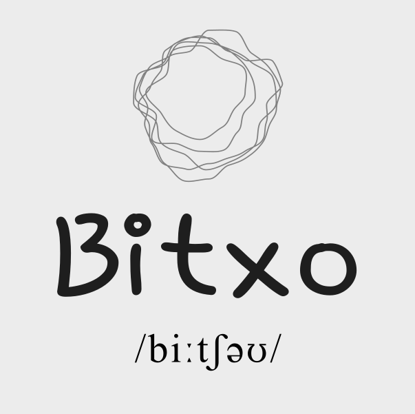

# Intro
Collection of Sonic Pi Experiments  

Recordings of some of the tunes:  
https://soundcloud.com/bitxo-music  

  

## Getting Started
1. Install Sonic Pi:
https://sonic-pi.net/

2. Play!

## Stomp Box app
[`stompbox/`](./stompbox) is an Android app that turns a phone into a foot-tap bass stomp box,
using the camera or the accelerometer. See its [README](./stompbox/README.md).
